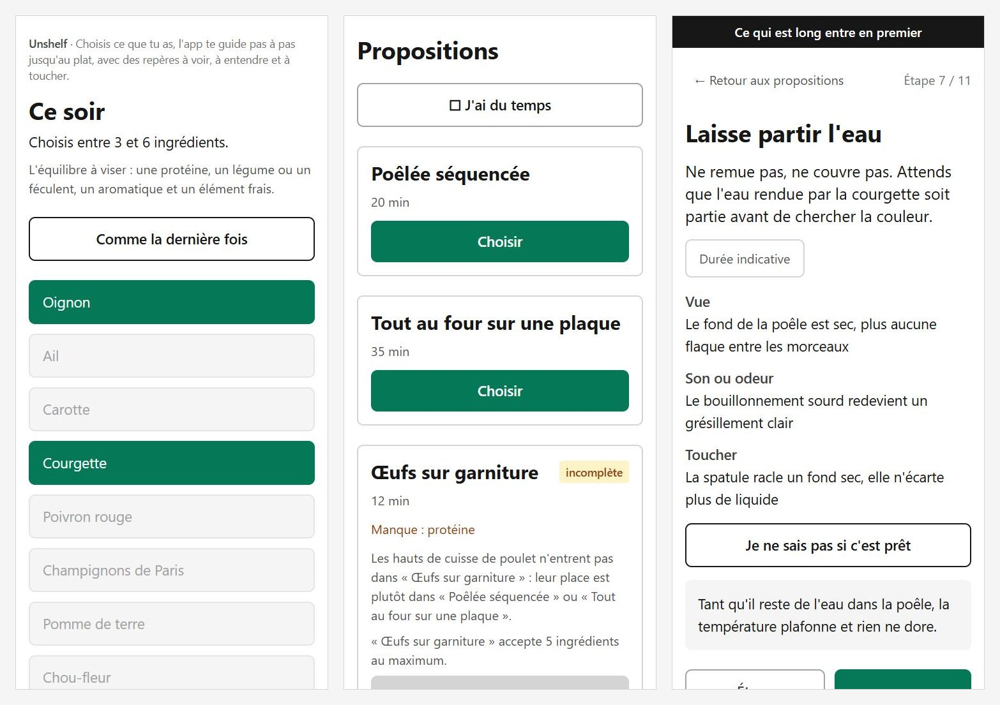

# Unshelf

**Live app: [unshelf.netlify.app](https://unshelf.netlify.app/)** · [Version française ↓](#français)



## English

**What it does.** Unshelf is a cooking companion for beginners. You tick what you have at
home, it suggests a dish and walks you through it step by step, right at the stove.

**How it works.**
- **Dish families, not recipes.** Pick 3 to 6 ingredients for tonight. An engine matches
  them against three cooking structures (pan-fry, sheet-pan roast, eggs on a base),
  assigns each ingredient a role (fat, protein, aromatic, body, acid, finish) and orders
  the steps: what takes longest goes in first, acid goes in off the heat.
- **Sensory cues instead of timers.** Each step tells you when it's ready by what you
  can see, hear or smell, and feel. Cooking times stay hidden behind a tap.
  A "Not sure it's ready?" button explains what's going on.

**Stack.** React 18 · Vite 5 · Tailwind CSS 3.4 · plain JavaScript · `localStorage`.
No backend, no account, no network calls. The generation engine is made of pure
functions (`src/engine/`) driven by JSON data (`src/data/`), and checked with
`node scripts/verifier.mjs`. Deployed on Netlify.

```bash
npm install
npm run dev                 # local app
node scripts/verifier.mjs   # engine and data checks
```

The interface is in French.

## Français

**Ce que fait l'app.** Unshelf accompagne un débutant en cuisine. Tu coches ce que tu as
chez toi, elle te propose un plat et te guide pas à pas, directement aux fourneaux.

**Le principe.**
- **Des familles de plats, pas des recettes.** Tu choisis 3 à 6 ingrédients pour ce soir.
  Un moteur les confronte à trois structures de cuisson (poêlée, plaque au four, œufs sur
  garniture), donne un rôle à chaque ingrédient (gras, protéine, aromatique, corps, acide,
  finition) et ordonne les étapes : ce qui est long entre en premier, l'acide se met feu
  coupé.
- **Des repères sensoriels plutôt qu'un minuteur.** Chaque étape dit quand c'est prêt par
  ce qu'on voit, ce qu'on entend ou sent, et ce qu'on touche. La durée reste masquée
  derrière un tap. Un bouton « Je ne sais pas si c'est prêt » explique ce qui se passe.

**Stack.** React 18 · Vite 5 · Tailwind CSS 3.4 · JavaScript · `localStorage`.
Pas de backend, pas de compte, aucun appel réseau. Le moteur de génération est fait de
fonctions pures (`src/engine/`) alimentées par des données JSON (`src/data/`), et vérifié
par `node scripts/verifier.mjs`. Déployé sur Netlify.

**Lien :** [unshelf.netlify.app](https://unshelf.netlify.app/)
